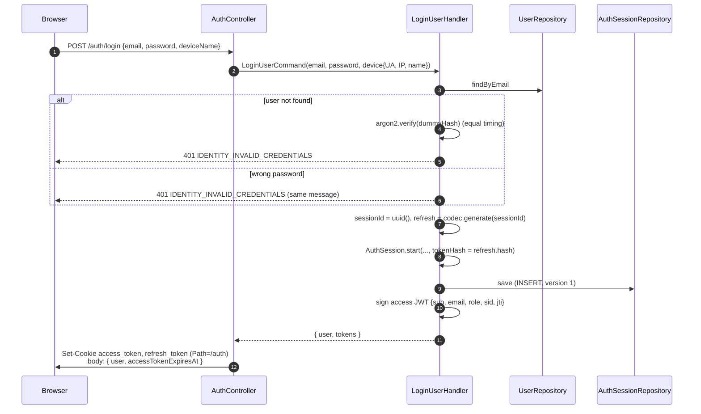
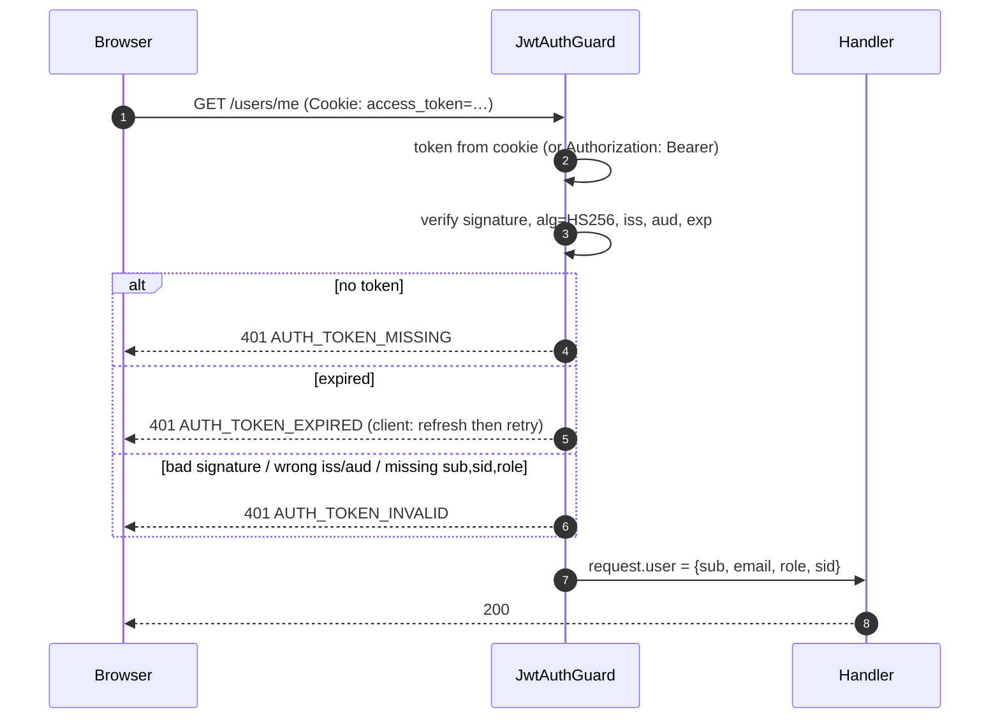
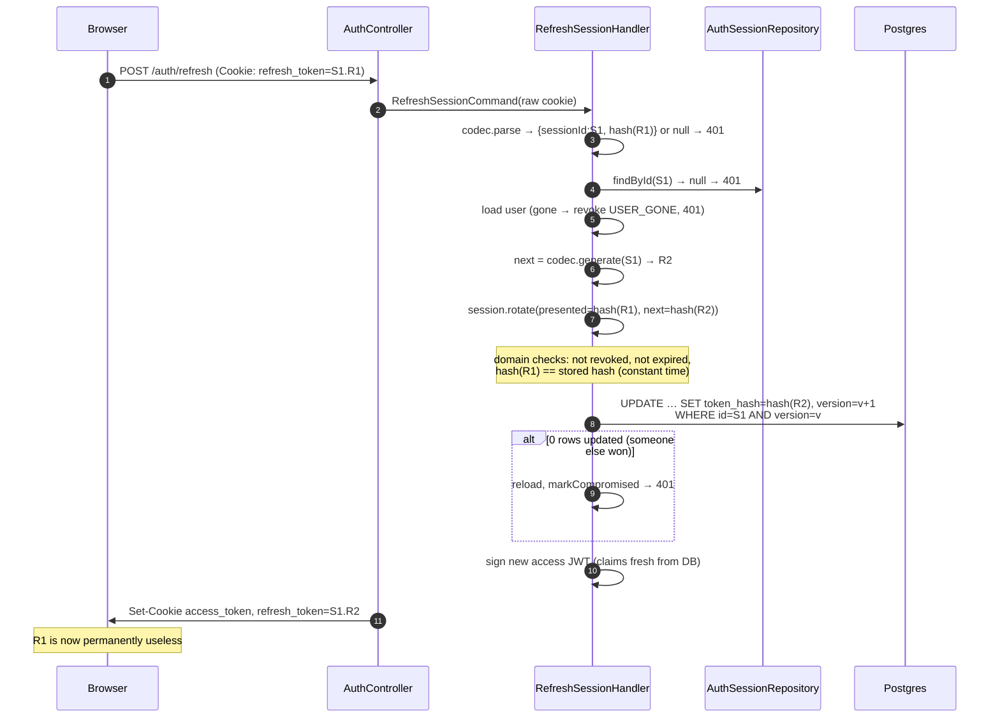
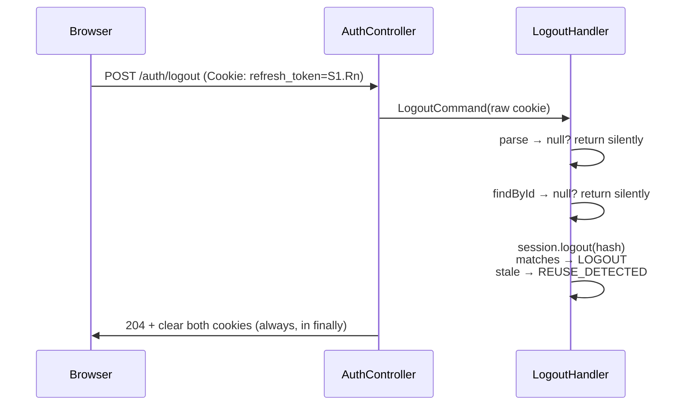

# Authentication & Authorization — How It Works

> A learning guide to the `identity` context: login, access tokens, refresh-token
> rotation, logout, multi-device sessions and authorization. It covers **what**
> happens, **why** it was designed this way, and **which attacks** each piece
> stops (and which it doesn't yet).

---

## Contents

1. [The big picture](#1-the-big-picture)
2. [Vocabulary](#2-vocabulary)
3. [Where every piece lives](#3-where-every-piece-lives)
4. [Anatomy of the two tokens](#4-anatomy-of-the-two-tokens)
5. [The session model (one row per device)](#5-the-session-model-one-row-per-device)
6. [Flow: Login](#6-flow-login)
7. [Flow: An authenticated request](#7-flow-an-authenticated-request)
8. [Flow: Authorization (roles and ownership)](#8-flow-authorization-roles-and-ownership)
9. [Flow: Refresh with rotation](#9-flow-refresh-with-rotation)
10. [Flow: Stolen refresh token (reuse detection)](#10-flow-stolen-refresh-token-reuse-detection)
11. [Flow: Two requests racing the same token](#11-flow-two-requests-racing-the-same-token)
12. [Flow: Logout, logout-all, revoke one session](#12-flow-logout-logout-all-revoke-one-session)
13. [Session expiry (idle vs absolute)](#13-session-expiry-idle-vs-absolute)
14. [Why this approach (design decisions)](#14-why-this-approach-design-decisions)
15. [Vulnerabilities: threat model](#15-vulnerabilities-threat-model)
16. [Known gaps and residual risks](#16-known-gaps-and-residual-risks)
17. [Frontend contract](#17-frontend-contract)
18. [Configuration](#18-configuration)
19. [Try it with curl](#19-try-it-with-curl)
20. [Code map](#20-code-map)
21. [Interview questions to practise](#21-interview-questions-to-practise)

---

## 1. The big picture

There are **two tokens** with opposite properties:

| | Access token | Refresh token |
|---|---|---|
| Format | JWT (signed, self-contained) | Opaque random string |
| Lifetime | 15 minutes | 7 days idle, 30 days absolute |
| Checked by | Signature only, with **no database lookup** | Database lookup **every time** |
| Sent on | Every API request | Only `/auth/refresh` and `/auth/logout` |
| Can be revoked instantly? | No (lives until `exp`) | Yes (revoke the session row) |
| Reusable? | Yes, until it expires | **No: single use, rotated each time** |

The access token is **fast but unrevocable**, so it is short-lived. The refresh
token is **revocable but needs a database hit**, so it is used rarely. Together
they give fast requests *and* the ability to log someone out.

```
login ──► [access 15m] [refresh R1]
            │ expires
            ▼
refresh(R1) ──► [access 15m] [refresh R2]      R1 is now dead forever
            │ expires
            ▼
refresh(R2) ──► [access 15m] [refresh R3]      R2 is now dead forever
            ...
logout(R3)  ──► session revoked, cookies cleared
```

---

## 2. Vocabulary

| Term | Meaning here |
|---|---|
| **Session** | One login on one device. A row in `identity.user_sessions`. Also called a *refresh-token family*. |
| **Rotation** | Every refresh replaces the refresh token with a new one; the old one stops working. |
| **Reuse** | A refresh token that was already rotated away is presented again. Only possible if a copy exists, so it signals theft. |
| **Revocation** | Marking a session dead (`revoked_at`, `revoked_reason`). Permanent. |
| **Pepper** | A server-side secret key (in env, **not** in the DB) mixed into the refresh-token hash. |
| **`sub`** | JWT claim: the user id. |
| **`sid`** | JWT claim: the session id. Links an access token to the device login that produced it. |
| **`jti`** | JWT claim: a unique id per access token (for a future denylist). |
| **Authentication** | *Who are you?* (valid token) |
| **Authorization** | *Are you allowed to do this?* (role, ownership) |

---

## 3. Where every piece lives

| Thing | Lives in | Why there |
|---|---|---|
| Access token | `access_token` cookie: `httpOnly`, `Secure`, `SameSite=Lax`, `Path=/` | JavaScript cannot read it, so XSS can't steal it. Sent automatically by the browser. |
| Refresh token | `refresh_token` cookie: `httpOnly`, `Secure`, `SameSite=Strict`, `Path=/auth` | Never sent on ordinary API calls, so it can't leak from them; never sent cross-site. |
| Refresh token (server side) | `identity.user_sessions.token_hash`, as `HMAC-SHA256(pepper, token)` | Needed for rotation and revocation. A DB leak gives nothing usable. |
| Pepper, JWT secret | Environment variables | Never in the DB or the repo, so a DB dump alone is not enough. |
| User profile | Login response body → frontend state (Redux) | Display data, not a credential. |
| Auth data in Booking, Payment, Catalog… | **Nothing** | They only keep `user_id` as a plain uuid. They trust `sub` from a verified token. |

> **Rule of thumb:** no token is ever put in a response body, in `localStorage`,
> or in a URL.

---

## 4. Anatomy of the two tokens

### 4.1 Access token (JWT, HS256)

```jsonc
// header
{ "alg": "HS256", "typ": "JWT" }
// payload
{
  "sub":   "7c1e…",            // user id
  "email": "ankit@example.com",
  "role":  "USER",             // USER | ADMIN
  "sid":   "3f1c2a8e-…",       // session (device) id
  "jti":   "b0a4…",            // unique per token
  "iat":   1767225600,
  "exp":   1767226500,         // iat + 900s
  "iss":   "ticket-booking-api",
  "aud":   "ticket-booking"
}
// signature = HMAC-SHA256(JWT_ACCESS_SECRET, header.payload)
```

On verification (`JwtModule.verifyOptions`) we **pin**:

- `algorithms: ['HS256']`. The token's own `alg` header is never trusted, which blocks `alg: none` and algorithm-confusion attacks.
- `issuer` and `audience`. A token minted for another app/service is rejected.
- `exp` (checked automatically).

### 4.2 Refresh token (opaque)

```
3f1c2a8e-6b7d-4e2f-9a1b-0c3d4e5f6a7b.Zq8l…43 base64url chars…
└────────── session id ────────────┘ └─ 32 random bytes (256 bits) ─┘
```

- The **session id** lets the server find the row with a primary-key lookup.
- The **secret** is 256 bits from `crypto.randomBytes`. Guessing it is impossible.
- The DB stores `HMAC-SHA256(pepper, "<sessionId>.<secret>")`:
  - The token itself is **never stored**.
  - Including the session id in the MAC input means a secret can't be moved to another session.
- `parse()` strictly validates the format (uuid + exactly 43 base64url chars, length ≤ 100) and returns `null` on anything else, so garbage never reaches the DB.

---

## 5. The session model (one row per device)

```
identity.user_sessions
┌──────────────────────┬──────────────────────────────────────────────┐
│ id                   │ uuid, also the first half of the refresh token │
│ user_id              │ uuid                                           │
│ token_hash           │ HMAC of the ONE refresh token valid right now  │
│ device_name          │ "Ankit's iPhone" (optional, from login body)   │
│ user_agent, ip_address│ for the "active sessions" screen              │
│ created_at           │ login time                                     │
│ last_used_at         │ last refresh                                   │
│ idle_expires_at      │ last_used_at + 7d (capped at absolute)         │
│ absolute_expires_at  │ created_at + 30d, never extended               │
│ revoked_at           │ null while alive                               │
│ revoked_reason       │ LOGOUT | LOGOUT_ALL | REVOKED_BY_USER |        │
│                      │ REUSE_DETECTED | USER_GONE                     │
│ version              │ optimistic lock                                │
└──────────────────────┴──────────────────────────────────────────────┘
```

Two devices = two rows = two independent token chains:

| Session | Device | Current token | Status |
|---|---|---|---|
| S1 | Laptop | R1 → R3 → R5 … | Active |
| S2 | iPhone | R2 → R4 → R6 … | Active |

- Refreshing on the laptop never touches the iPhone's row.
- If the laptop's token is stolen and replayed, **only S1** is revoked.
- Logout on the laptop revokes only S1.
- "Log out everywhere" revokes S1 and S2.

All of these rules live in the **`AuthSession` aggregate**
(`src/identity/domain/session/auth-session.aggregate.ts`), not in handlers or
controllers.

---

## 6. Flow: Login

`POST /auth/login` `{ email, password, deviceName? }`



Key points:

1. **Same error, same time** for "no such email" and "wrong password". A dummy
   argon2 verification runs for unknown emails, so response latency doesn't
   reveal which emails are registered (account enumeration).
2. **Every login creates a new session.** Logging in on the iPhone does not
   touch the laptop's session.
3. **New session id on every login.** An attacker can't plant a session id
   before login (session fixation).
4. The body contains the **profile**, not tokens, so the frontend can render
   "Hi Ankit" without a second request.
5. Response has `Cache-Control: no-store` so no proxy or browser cache keeps it.

---

## 7. Flow: An authenticated request

Example: `GET /users/me`



- **No database call.** That is the whole point of a JWT access token.
- The guard copies only known claims into `request.user`, so extra claims in a
  token are ignored.
- The access cookie deliberately lives **longer** than the JWT inside it
  (until the refresh token expires). If the cookie disappeared exactly at
  `exp`, the browser would send nothing and the API could only say
  `AUTH_TOKEN_MISSING`. Keeping it lets the API say `AUTH_TOKEN_EXPIRED`, which
  is the client's signal to refresh. An expired JWT is worthless, so keeping
  it around costs nothing.
- Bearer header support exists for non-browser clients and tests. Browsers use
  the cookie.

---

## 8. Flow: Authorization (roles and ownership)

Authentication answers *who*. Authorization answers *may they*. There are
three different questions with three different answerers:

| Question | Answered by | How |
|---|---|---|
| Is this a real, unexpired token? | `JwtAuthGuard` | Signature + claims |
| Is this person an ADMIN? | `RolesGuard` + `@Roles(UserRole.ADMIN)` | `role` claim |
| Does this person own booking 8841 / session S1? | **The owning context's handler/aggregate** | Compare `sub` with the resource's `userId` |

```ts
@UseGuards(JwtAuthGuard, RolesGuard)   // order matters: authenticate first
@Roles(UserRole.ADMIN)
@Post('movies')
createMovie(...) {}
```

**Ownership example already in the code:** `DELETE /auth/sessions/:id`.

```ts
// RevokeSessionHandler
if (!session || !session.belongsTo(command.userId)) {
  throw new SessionNotFoundError(command.sessionId);   // 404, not 403
}
```

Returning **404 instead of 403** for someone else's resource is deliberate.
A 403 would confirm "this id exists, it just isn't yours", which helps an
attacker enumerate ids. This is the defence against **IDOR** (Insecure Direct
Object Reference), the #1 item in OWASP API Top 10 ("Broken Object Level
Authorization").

**Role freshness:** the `role` claim is a snapshot from issue time. If an admin
is demoted, their access token still says ADMIN for up to 15 minutes. At the
next refresh, claims are **rebuilt from the database**, so the demotion takes
effect then. For instant effect, revoke their sessions (`logout-all`) and add
the denylist from §16.

**Events and background jobs carry no token.** When Booking consumes
`PaymentSucceeded`, the actor's user id travels inside the event payload. The
message broker is inside the trust boundary. Never forge a user token for a
background job.

---

## 9. Flow: Refresh with rotation

`POST /auth/refresh`. No body, no access token needed (it's usually expired).



**What can go wrong, and what the client sees:**

| Situation | Domain outcome | HTTP |
|---|---|---|
| No cookie / garbage cookie | `InvalidRefreshTokenError` | 401 `IDENTITY_INVALID_REFRESH_TOKEN` |
| Unknown session id | `InvalidRefreshTokenError` | 401 |
| Session revoked | `SessionRevokedError` | 401 `IDENTITY_SESSION_REVOKED` |
| Idle or absolute expiry passed | `SessionExpiredError` | 401 `IDENTITY_SESSION_EXPIRED` |
| Old token replayed | session **revoked**, `RefreshTokenReuseDetectedError` | 401 `IDENTITY_REFRESH_TOKEN_REUSED` |
| Lost the optimistic-lock race | session **revoked** | 401 `IDENTITY_REFRESH_TOKEN_REUSED` |

All of these return the same human message ("Session is no longer valid,
please sign in again"), and on **any** failure the controller **clears both
cookies**. The client must never retry a failed refresh.

---

## 10. Flow: Stolen refresh token (reuse detection)

This is the core security property. Suppose malware copies the laptop's
refresh token `R1`.

**Case A: the user refreshes first, then the attacker tries.**

```
t=0   user:     refresh(R1) → OK, gets R2        stored hash = h(R2)
t=1   attacker: refresh(R1) → h(R1) ≠ h(R2)
                → session S1 REVOKED (REUSE_DETECTED)
                → RefreshTokenReuseDetected event
                → 401
t=2   user:     refresh(R2) → S1 is revoked → 401 → must log in again
```

**Case B: the attacker refreshes first, then the user.**

```
t=0   attacker: refresh(R1) → OK, gets R2 (attacker now "owns" S1)
t=1   user:     refresh(R1) → h(R1) ≠ h(R2) → S1 REVOKED → 401
t=2   attacker: refresh(R2) → S1 is revoked → 401   ← attacker locked out
```

Either way, **at most one party continues, and only until the other one shows
up**. After that, nobody does. The server can't tell which party is the thief,
so it kills the whole session. The real user just logs in again, getting a
brand-new session S3 that the attacker knows nothing about.

The iPhone's session S2 is **untouched** the whole time.

**Why does the old token's replay detection work without a history table?**
The token contains its session id. We look up the session, and the stored hash
is only ever the *current* token's hash. Any well-formed token for that session
whose hash doesn't match must be an old one. Forging a different secret for a
known session id is impossible without the pepper, and knowing the session id
at all requires having held a real token.

**The `RefreshTokenReuseDetected` event** is a security signal. The
Notification context can later consume it and email the user ("Someone may have
accessed your account from …").

---

## 11. Flow: Two requests racing the same token

Two requests arrive within milliseconds, both carrying R1. Both load the session
at `version = 4` and both pass the hash check in memory. Without protection,
both would issue a new token, creating two valid chains from one token.

The repository uses **optimistic locking (compare-and-swap)**:

```sql
UPDATE identity.user_sessions
   SET token_hash = $new, …, version = 5
 WHERE id = $S1 AND version = 4;     -- only one UPDATE can match
```

- The winner updates 1 row and gets R2.
- The loser updates **0 rows** → `ConcurrentSessionUpdateError` → the handler
  reloads the session, calls `markCompromised()` (revokes it), returns 401.

**Trade-off:** two legitimate browser tabs refreshing at the same instant will
log the user out. This is chosen on purpose (strict security over
convenience). The frontend prevents it with a single in-flight refresh across
tabs (§17). The softer alternative is a short grace window where the
just-rotated token is accepted for a few seconds. It is friendlier, but it
reopens a small replay window. Many real systems use it; this project chooses
strictness.

---

## 12. Flow: Logout, logout-all, revoke one session

### 12.1 `POST /auth/logout` (this device)



- **No access token required.** The user must be able to log out even when the
  access token has expired. The refresh cookie identifies the session, and its
  `Path=/auth` means it reaches `/auth/logout`.
- **Idempotent and silent.** Logging out twice, or with no cookie, is still
  `204`. Logout should never fail from the user's point of view.
- **Cookies are cleared in a `finally`**, even if the database is down.
- **A stale token still ends the session**, but it is recorded as
  `REUSE_DETECTED`, because whoever sent it shouldn't have had it.
- **CSRF:** the refresh cookie is `SameSite=Strict`, so another website can't
  make the browser send it and force-logout the user.

### 12.2 `POST /auth/logout-all` (every device)

Requires a valid access token. Loads every active session of `sub`, revokes
each one (`LOGOUT_ALL`), saves each separately (one aggregate per save), clears
this device's cookies, and returns `{ revoked: n }`.

Use it after a password change, when the user suspects compromise, or for a
"sign out everywhere" button.

### 12.3 `GET /auth/sessions` and `DELETE /auth/sessions/:id`

- `GET` lists active sessions, flagging the caller's own with `current: true`
  (matched via the `sid` claim). The token hash is never exposed.
- `DELETE` revokes one session (`REVOKED_BY_USER`). There is an ownership
  check, and someone else's session gets a 404. If you revoke your *own*
  current session, your cookies are cleared too.

### 12.4 What logout does **not** do (yet)

The access token in the attacker's or user's hands remains valid until its
`exp`, **up to 15 minutes**, because access tokens are checked without a
database. See §16 for the Redis denylist that closes this.

---

## 13. Session expiry (idle vs absolute)

```
login                                             absolute (30d)
  │◄────────── idle 7d ──────────►│                    │
  │   refresh   │◄──── idle 7d ────────►│              │
  │             │   refresh  │◄──── idle 7d ─────────►│ (capped)
  ▼             ▼            ▼                         ▼
──┼─────────────┼────────────┼─────────────────────────┼──► time
                                          session dies here, no matter what
```

- **Idle expiry (sliding):** if the device doesn't refresh for 7 days, the
  session dies. An abandoned laptop is not logged in forever.
- **Absolute expiry (fixed):** 30 days after login the session dies even if
  it's refreshed every hour. An attacker who silently keeps a stolen session
  alive is cut off eventually, and the user re-enters their password at least
  monthly.
- Rotation never pushes `idle_expires_at` past `absolute_expires_at`.
- `SessionLifetime.of()` rejects nonsense config (non-positive, idle > absolute)
  at startup.

---

## 14. Why this approach (design decisions)

### 14.1 Cookies vs `localStorage` for tokens

| | `localStorage` + `Authorization` header | **httpOnly cookie (chosen)** |
|---|---|---|
| Readable by XSS? | **Yes.** One injected script exfiltrates the token. | No |
| CSRF risk? | None | Yes, mitigated by `SameSite` (below) |
| Works with Next.js Server Components / SSR? | No (the server can't see localStorage) | Yes |

XSS is the more common and more damaging bug, so we pick the storage that XSS
can't read and close CSRF separately. (XSS can still *make requests* while the
page is open. httpOnly stops *theft*, not *abuse in place*. CSP and output
encoding are still needed.)

### 14.2 Short JWT access + opaque rotating refresh vs alternatives

| Option | Problem |
|---|---|
| Long-lived JWT only | Can't revoke. A stolen token works for days. |
| Classic server session (session id cookie + DB/Redis lookup per request) | Every request hits shared storage. Every service in Phase 5 would need to call identity. |
| Refresh token as a JWT too | Still needs a DB row to revoke/rotate, so the JWT format adds nothing but size and a bigger attack surface. |
| **Short JWT + opaque refresh (chosen)** | Stateless fast path for 99% of requests; revocation via the refresh path. |

### 14.3 Rotation + reuse detection vs a static refresh token

A static refresh token, once stolen, works until it expires and the theft is
**invisible**. Rotation makes every token single-use, so a stolen copy
**collides** with the real user's next refresh and the theft becomes
detectable. This is the approach in the OAuth 2.0 Security Best Current Practice
(RFC 9700 §4.14).

### 14.4 One session (token family) per device vs one refresh token per user

With a single token per user, logging in on the phone would kill the laptop,
and a reuse detection would log out *everything*. Per-session families give:
independent devices, targeted revocation, a "where am I logged in" screen, and
per-device logout.

### 14.5 HMAC-SHA256 + pepper vs bcrypt/argon2 for refresh tokens

Passwords are low-entropy, so they need a **slow** hash (argon2id) to resist
guessing. Refresh tokens have **256 bits of randomness**, and nobody can
brute-force that even with a fast hash. A slow hash would only make every
refresh slower. HMAC with a pepper adds: a DB dump without the env secret
can't even be used to *test* a candidate token.

### 14.6 `<sessionId>.<secret>` format

Lookup by primary key (O(1)) instead of searching by hash, and it enables
reuse detection without a token-history table (§10).

### 14.7 Optimistic locking vs `SELECT … FOR UPDATE`

Contention on one session is rare (one device), so optimistic locking avoids
holding row locks and keeps the repository simple. The conflict path is
treated as a security event, not retried.

### 14.8 Rules in the aggregate, not in handlers

"Mismatch → revoke", "never past absolute expiry", and "revoked stays revoked"
are business rules, so they live in `AuthSession` and are unit-tested without
a database (`auth-session.aggregate.spec.ts`). Handlers only load, call the
domain, save, and publish.

### 14.9 `SameSite=Lax` for access, `Strict` for refresh

- `Lax` still sends the access cookie on top-level link navigation (e.g.
  clicking a link to the app from an email), but **not** on cross-site
  POST/PUT/DELETE, which is what CSRF needs. Rule that follows: **GET routes
  must never change state.**
- The refresh cookie is never needed on a cross-site navigation, so it gets
  the strictest setting.

---

## 15. Vulnerabilities: threat model

| # | Attack | How it works | Mitigation in this code | Residual risk |
|---|---|---|---|---|
| 1 | **XSS token theft** | Injected JS reads tokens and sends them away | Both tokens are `httpOnly`; no token in body, storage or URL | XSS can still act *as the user* while the tab is open. Needs CSP, escaping. |
| 2 | **CSRF** | Evil site makes the browser POST to our API with cookies | `SameSite=Lax` (access) / `Strict` (refresh); state changes only on non-GET | Subdomain takeover / same-site attackers bypass SameSite. Add a CSRF token or `Origin` check if subdomains are untrusted. |
| 3 | **Refresh token theft & replay** | Copy from disk, malware, a proxy log | Single-use rotation; replay revokes the session; 30d absolute cap | The thief can use it **until** the real user refreshes (≤ 15 min of activity, typically). |
| 4 | **Race to double-spend a refresh token** | Send the same token twice concurrently | Optimistic lock: only one UPDATE wins; loser revokes the session | Two legit tabs can log the user out (UX, not security). |
| 5 | **Database leak** | Attacker dumps `user_sessions` | Only HMAC hashes stored; pepper is in env | If **env** leaks too, hashes can verify guesses, but 256-bit secrets still can't be guessed. Rotate the pepper (logs everyone out). |
| 6 | **JWT secret leak** | Attacker forges any access token | Secret ≥ 32 chars enforced at boot; env only | Total compromise until the secret is rotated. RS256 (Phase 5) limits who holds the signing key. |
| 7 | **`alg: none` / algorithm confusion** | Token claims a weaker or no algorithm | `algorithms: ['HS256']` pinned in verify | — |
| 8 | **Token for another app/audience** | Reuse a JWT from a sibling service | `iss` and `aud` pinned | — |
| 9 | **Timing attack on hash compare** | Measure response time to learn the stored hash | `constantTimeEquals` | Network noise makes this impractical anyway. Defence in depth. |
| 10 | **Account enumeration** | Different errors/timings for unknown email | Same error + dummy argon2 verify | Register still says "email already registered" (409). Common trade-off, so consider it. |
| 11 | **Credential stuffing / brute force** | Many login attempts | argon2id makes each guess expensive | **No rate limiting yet** (§16). |
| 12 | **Session fixation** | Attacker sets a known session id before login | A new random session id and token on every login; server never accepts a client-chosen id | — |
| 13 | **IDOR on sessions** | `DELETE /auth/sessions/<someone else's id>` | Ownership check, 404 for foreign ids | Every future context must do its own ownership checks. |
| 14 | **Stale privileges** | Demoted admin keeps the ADMIN claim | Claims rebuilt from the DB on every refresh | Up to 15 min of stale role (§16). |
| 15 | **Deleted user keeps access** | Account removed, tokens remain | Refresh revokes the session (`USER_GONE`) | Access token valid ≤ 15 min. |
| 16 | **Malformed-input attacks** | Huge or odd cookie values | Strict regex, max length 100, `null` on failure, no DB hit | — |
| 17 | **Token in logs / caches** | Proxies or logs capture tokens | Tokens only in cookies; refresh cookie only on `/auth`; `Cache-Control: no-store` | Never log the `Cookie` header (configure pino redaction). |
| 18 | **MITM / sniffing** | Read cookies on plain HTTP | `Secure` cookies (default on) | Needs HTTPS + HSTS in deployment. `COOKIE_SECURE=false` is for local dev only. |
| 19 | **Force-logout CSRF** | Evil site hits `/auth/logout` | Refresh cookie `SameSite=Strict` isn't sent cross-site | — |
| 20 | **Long-lived stolen session** | Attacker keeps refreshing forever | Absolute 30-day expiry | — |

---

## 16. Known gaps and residual risks

These are known, deliberate deferrals, each with the fix that closes it.

1. **Access token survives logout for up to 15 minutes.**
   Fix (when Redis lands): on revoke, `SET denylist:sid:<sid> 1 EX <remaining access TTL>`;
   `JwtAuthGuard` rejects tokens whose `sid` is denylisted. That's one Redis
   `GET` per request, still no Postgres hit.
2. **No rate limiting** on `/auth/login`, `/auth/refresh`, `/auth/register`.
   Fix: `@nestjs/throttler` with Redis storage, per IP and per email, plus
   lockout/backoff after N failures.
3. **Concurrent tabs can trigger reuse detection.** Fix on the client (§17), or
   add a small grace window server-side (weaker).
4. **Expired/revoked session rows are never deleted.** Fix: a nightly job
   deleting rows where `absolute_expires_at < now() - 30 days` (keep some
   history for audit).
5. **HS256 shared secret.** Fine in a monolith. In Phase 5, switch to **RS256**:
   identity holds the private key, other services get only the public key
   (via JWKS), so a compromised service can't mint tokens.
6. **No password change / reset flow yet.** When added, it must call
   logout-all (revoke every session) after changing the password.
7. **Reuse-detected notification isn't sent yet.** The event is raised;
   Notification needs a consumer.
8. **Events are published after save, not via outbox.** If the process dies
   between the two, the event is lost. The project's outbox (later phase)
   fixes this.
9. **`trust proxy` is not configured**, so behind a load balancer `req.ip` will
   be the proxy's IP. Set `app.set('trust proxy', 1)` in deployment.

---

## 17. Frontend contract

```ts
// RTK Query baseQuery wrapper: the essential logic
let refreshing: Promise<boolean> | null = null;

async function baseQueryWithRefresh(args, api, extra) {
  let result = await rawBaseQuery(args, api, extra);   // credentials: 'include'

  const code = result.error?.data?.code;
  if (result.error?.status === 401 &&
      (code === 'AUTH_TOKEN_EXPIRED' || code === 'AUTH_TOKEN_MISSING')) {
    // ONE refresh for any number of parallel 401s
    refreshing ??= navigator.locks.request('auth-refresh', async () => {
      const r = await rawBaseQuery({ url: '/auth/refresh', method: 'POST' }, api, extra);
      return !r.error;
    }).finally(() => { refreshing = null; });

    if (await refreshing) {
      result = await rawBaseQuery(args, api, extra);    // retry once
    } else {
      api.dispatch(loggedOut());                        // clear state, go to /login
    }
  }
  return result;
}
```

Rules:

- Always send `credentials: 'include'`. Never read or store tokens in JS (you can't anyway).
- **React** to 401s; don't refresh on a timer.
- One refresh at a time, across tabs (`navigator.locks` or `BroadcastChannel`).
  This avoids the race in §11.
- **Never retry a failed refresh.** It means the session is over.
- Don't call `/auth/refresh` for a 401 that came *from* `/auth/refresh` or `/auth/login`.
- Logout: `POST /auth/logout`, then clear local state regardless of the response.

---

## 18. Configuration

| Variable | Default | Notes |
|---|---|---|
| `JWT_ACCESS_SECRET` | — (required) | ≥ 32 chars, else boot fails. `openssl rand -base64 48` |
| `JWT_ACCESS_TTL_SECONDS` | `900` | Converted with `Number()`. A raw string `"900"` would mean 900 **ms** to `jsonwebtoken`. |
| `JWT_ISSUER` | `ticket-booking-api` | Pinned on sign and verify |
| `JWT_AUDIENCE` | `ticket-booking` | Pinned on sign and verify |
| `REFRESH_TOKEN_PEPPER` | — (required) | ≥ 32 chars. Changing it invalidates every refresh token. |
| `REFRESH_TOKEN_IDLE_TTL_SECONDS` | `604800` (7d) | Sliding |
| `SESSION_ABSOLUTE_TTL_SECONDS` | `2592000` (30d) | Must be ≥ idle |
| `COOKIE_SECURE` | `true` unless set to `false` | `false` only for local `http://` |
| `COOKIE_DOMAIN` | unset (host-only) | Set only if the frontend is on a sibling subdomain |

---

## 19. Try it with curl

```bash
API=http://localhost:3000
JAR=$(mktemp)

# login (stores both cookies in the jar)
curl -i -c $JAR -X POST $API/auth/login \
  -H 'Content-Type: application/json' \
  -d '{"email":"ankit@example.com","password":"S3cure-pass","deviceName":"curl"}'

# authenticated call (cookie sent automatically)
curl -b $JAR $API/users/me

# list sessions
curl -b $JAR $API/auth/sessions

# keep the current refresh token, then rotate
OLD=$(grep refresh_token $JAR | awk '{print $7}')
curl -i -b $JAR -c $JAR -X POST $API/auth/refresh

# replay the OLD token → 401 IDENTITY_REFRESH_TOKEN_REUSED, session revoked
curl -i -X POST $API/auth/refresh --cookie "refresh_token=$OLD"

# now even the NEW token fails → 401 IDENTITY_SESSION_REVOKED
curl -i -b $JAR -X POST $API/auth/refresh

# logout (always 204)
curl -i -b $JAR -c $JAR -X POST $API/auth/logout
```

To inspect the database:

```sql
SELECT id, device_name, revoked_reason, last_used_at, idle_expires_at, version
  FROM identity.user_sessions
 WHERE user_id = '<uuid>'
 ORDER BY created_at DESC;
```

---

## 20. Code map

| Layer | File | Role |
|---|---|---|
| Domain | `domain/session/auth-session.aggregate.ts` | All session rules: start, rotate, logout, revoke, markCompromised, expiry |
| Domain | `domain/session/session-lifetime.vo.ts` | Idle/absolute TTL value object |
| Domain | `domain/session/session-revocation-reason.enum.ts` | Why a session ended |
| Domain | `domain/session/auth-session.repository.ts` | Repository port (optimistic `save`) |
| Domain | `domain/events/session-*.event.ts`, `refresh-token-reuse-detected.event.ts` | Domain events |
| Domain | `shared/domain/constant-time-equals.ts` | Timing-safe compare, pure TS |
| Application | `commands/login-user/` | Verify password, start session, issue tokens |
| Application | `commands/refresh-session/` | Rotate, handle reuse and race |
| Application | `commands/logout/`, `logout-all-sessions/`, `revoke-session/` | Ending sessions |
| Application | `queries/list-my-sessions/` | "Where am I logged in" |
| Application | `ports/refresh-token-codec.port.ts`, `access-token-issuer.port.ts` | Crypto behind interfaces |
| Infrastructure | `security/hmac-refresh-token-codec.adapter.ts` | Token generate/parse/HMAC |
| Infrastructure | `security/jwt-access-token-issuer.adapter.ts` | Sign JWT, compute `expiresAt` |
| Infrastructure | `persistence/typeorm-auth-session.repository.ts` | Compare-and-swap `UPDATE … WHERE version = ?` |
| Presentation | `cookies/auth-cookies.ts` | The only place that knows cookie names and flags |
| Presentation | `guards/jwt-auth.guard.ts`, `roles.guard.ts` | Authentication and role authorization |
| Presentation | `controllers/auth.controller.ts` | Thin HTTP adapter |
| Wiring | `identity.module.ts` | JWT pinning, TTL config, port → adapter bindings |

(Paths are relative to `src/identity/` unless they start with `shared/`.)

Tests:
`domain/session/auth-session.aggregate.spec.ts` (rotation, reuse, expiry,
idempotent revoke) and
`infrastructure/security/hmac-refresh-token-codec.adapter.spec.ts` (round-trip,
pepper, session binding, malformed input).

---

## 21. Interview questions to practise

Answer these out loud without looking at the doc.

1. Why two tokens instead of one?
2. Why is the access token a JWT but the refresh token opaque?
3. Where do you store tokens in the browser, and what attack does each choice expose you to?
4. Walk through what happens when a stolen refresh token is used *before* and *after* the real user refreshes.
5. How do you detect reuse without storing every old token?
6. Two requests refresh with the same token at the same millisecond. What happens, and why?
7. Why HMAC-SHA256 for refresh tokens but argon2id for passwords?
8. What is a pepper and how does it differ from a salt?
9. A user clicks logout. Can their access token still be used? For how long? How would you fix it?
10. Why does logout not require an access token?
11. What does `SameSite=Lax` protect against and what doesn't it? Why is the refresh cookie `Strict`?
12. Why return 404 instead of 403 for someone else's session?
13. An admin is demoted. When does it take effect, and how would you make it instant?
14. Why pin `algorithms` when verifying a JWT?
15. What changes when you split into microservices (hint: RS256/JWKS, the edge verifies, services re-verify, events carry no tokens)?
16. Idle vs absolute expiry: what does each defend against?
17. Why do the session rules live in the aggregate rather than in the handler?
