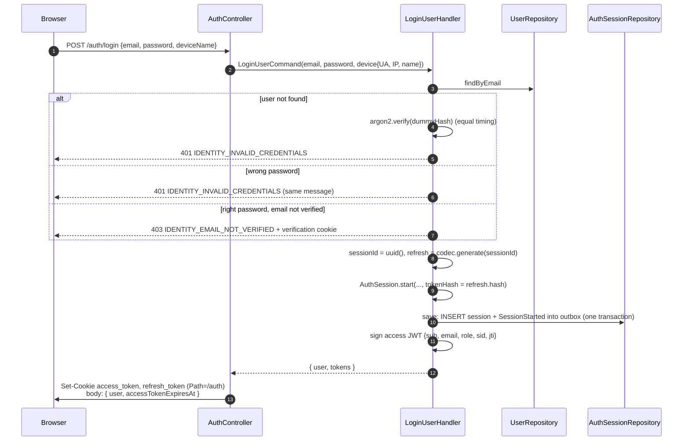
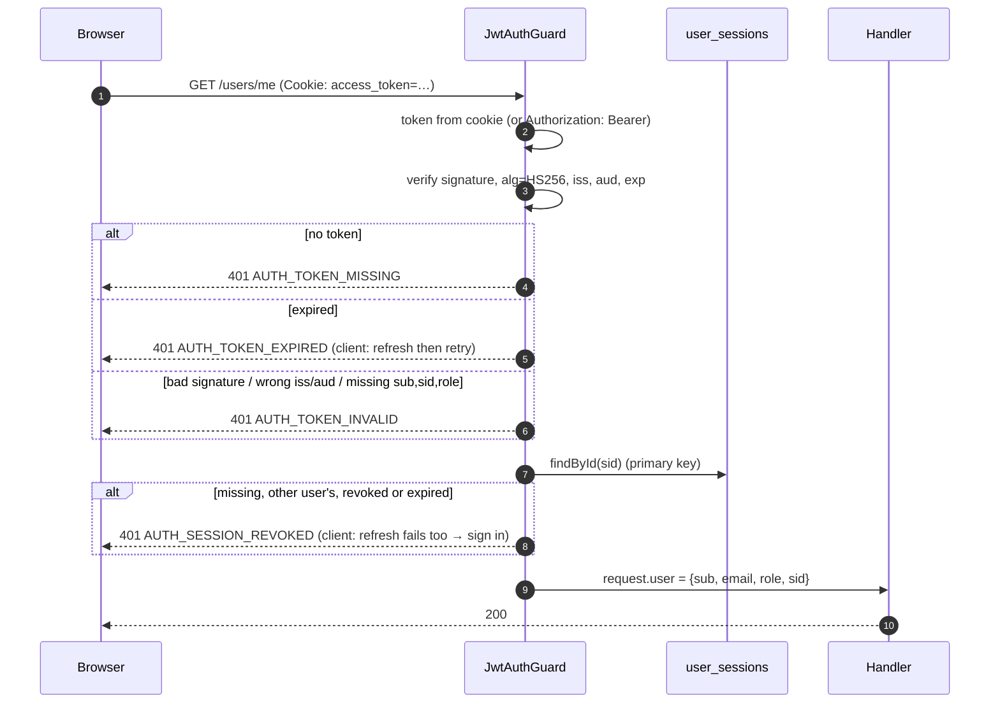
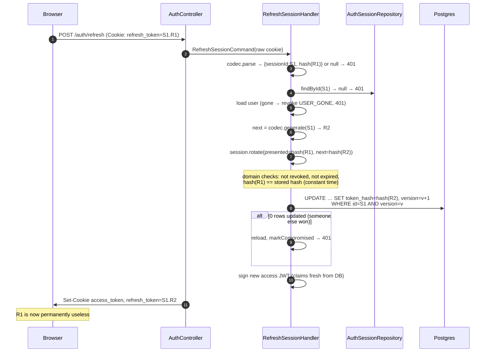
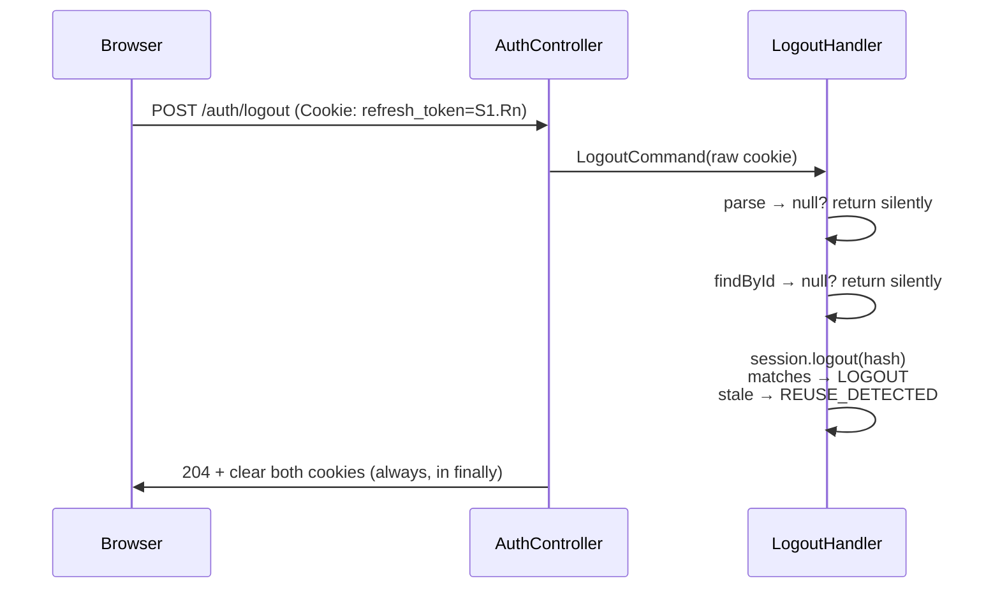
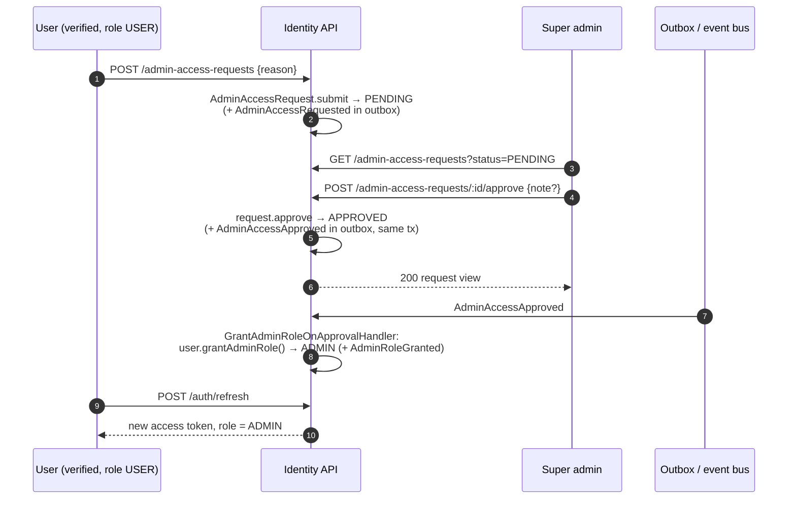

# Authentication & Authorization — How It Works

> A learning guide to the `identity` context: login, access tokens, refresh-token
> rotation, logout, multi-device sessions, roles (USER / ADMIN / SUPER_ADMIN)
> with admins by approval, and how identity's events leave through a
> transactional outbox. It covers **what** happens, **why** it was designed
> this way, and **which attacks** each piece stops (and which it doesn't yet).
>
> Contact verification and password reset are summarised in `docs/openapi.yaml`
> (use cases UC-1, UC-5, UC-6) and the ADRs in `docs/adr/`.

---

## Contents

1. [The big picture](#1-the-big-picture)
2. [Vocabulary](#2-vocabulary)
3. [Where every piece lives](#3-where-every-piece-lives)
4. [Anatomy of the two tokens](#4-anatomy-of-the-two-tokens)
5. [The session model (one row per device)](#5-the-session-model-one-row-per-device)
6. [Flow: Login](#6-flow-login)
7. [Flow: An authenticated request](#7-flow-an-authenticated-request)
8. [Flow: Authorization (roles and ownership)](#8-flow-authorization-roles-and-ownership)
9. [Flow: Refresh with rotation](#9-flow-refresh-with-rotation)
10. [Flow: Stolen refresh token (reuse detection)](#10-flow-stolen-refresh-token-reuse-detection)
11. [Flow: Two requests racing the same token](#11-flow-two-requests-racing-the-same-token)
12. [Flow: Logout, logout-all, revoke one session](#12-flow-logout-logout-all-revoke-one-session)
13. [Session expiry (idle vs absolute)](#13-session-expiry-idle-vs-absolute)
14. [Roles and admins by approval](#14-roles-and-admins-by-approval)
15. [Events: the transactional outbox](#15-events-the-transactional-outbox)
16. [Housekeeping: deleting dead rows](#16-housekeeping-deleting-dead-rows)
17. [Why this approach (design decisions)](#17-why-this-approach-design-decisions)
18. [Vulnerabilities: threat model](#18-vulnerabilities-threat-model)
19. [Known gaps and residual risks](#19-known-gaps-and-residual-risks)
20. [Frontend contract](#20-frontend-contract)
21. [Configuration](#21-configuration)
22. [Try it with curl](#22-try-it-with-curl)
23. [Code map](#23-code-map)
24. [Interview questions to practise](#24-interview-questions-to-practise)

---

## 1. The big picture

There are **two tokens** with opposite properties:

| | Access token | Refresh token |
|---|---|---|
| Format | JWT (signed, self-contained) | Opaque random string |
| Lifetime | 15 minutes | 7 days idle, 30 days absolute |
| Checked by | Signature + **one primary-key lookup** of its session | Database lookup + hash compare **every time** |
| Sent on | Every API request | Only `/auth/refresh` and `/auth/logout` |
| Can be revoked instantly? | Yes, indirectly: revoking its session (`sid`) makes the guard reject it | Yes (revoke the session row) |
| Reusable? | Yes, until it expires | **No: single use, rotated each time** |

The access token is **cheap to check** (signature + one indexed lookup to make
sure its session is still alive) and short-lived. The refresh token is
**single-use and rotated**, so a stolen copy is detected (§10). Together they
give fast requests, instant logout, and theft detection.

> Earlier versions checked the access token by signature only (zero DB hits),
> so a logged-out token kept working for up to 15 minutes. The guard now also
> loads the session by primary key on each request; see §7 for the trade-off.

```
login ──► [access 15m] [refresh R1]
            │ expires
            ▼
refresh(R1) ──► [access 15m] [refresh R2]      R1 is now dead forever
            │ expires
            ▼
refresh(R2) ──► [access 15m] [refresh R3]      R2 is now dead forever
            ...
logout(R3)  ──► session revoked, cookies cleared
```

---

## 2. Vocabulary

| Term | Meaning here |
|---|---|
| **Session** | One login on one device. A row in `identity.user_sessions`. Also called a *refresh-token family*. |
| **Rotation** | Every refresh replaces the refresh token with a new one; the old one stops working. |
| **Reuse** | A refresh token that was already rotated away is presented again. Only possible if a copy exists, so it signals theft. |
| **Revocation** | Marking a session dead (`revoked_at`, `revoked_reason`). Permanent. |
| **Pepper** | A server-side secret key (in env, **not** in the DB) mixed into the refresh-token hash. |
| **`sub`** | JWT claim: the user id. |
| **`sid`** | JWT claim: the session id. Links an access token to the device login that produced it. |
| **`jti`** | JWT claim: a unique id per access token (handy in logs; would key a denylist if one were ever needed). |
| **Outbox** | The `identity.outbox` table: events are written there in the same transaction as the change that raised them, then published (§15). |
| **Super admin** | The one `SUPER_ADMIN` account, created by the seed script. It approves admins (§14). |
| **Authentication** | *Who are you?* (valid token) |
| **Authorization** | *Are you allowed to do this?* (role, ownership) |

---

## 3. Where every piece lives

| Thing | Lives in | Why there |
|---|---|---|
| Access token | `access_token` cookie: `httpOnly`, `Secure`, `SameSite=Lax`, `Path=/` | JavaScript cannot read it, so XSS can't steal it. Sent automatically by the browser. |
| Refresh token | `refresh_token` cookie: `httpOnly`, `Secure`, `SameSite=Strict`, `Path=/auth` | Never sent on ordinary API calls, so it can't leak from them; never sent cross-site. |
| Refresh token (server side) | `identity.user_sessions.token_hash`, as `HMAC-SHA256(pepper, token)` | Needed for rotation and revocation. A DB leak gives nothing usable. |
| Pepper, JWT secret | Environment variables | Never in the DB or the repo, so a DB dump alone is not enough. |
| User profile | Login response body → frontend state (Redux) | Display data, not a credential. |
| Auth data in Booking, Payment, Catalog… | **Nothing** | They only keep `user_id` as a plain uuid. They trust `sub` from a verified token. |

> **Rule of thumb:** no token is ever put in a response body, in `localStorage`,
> or in a URL.

---

## 4. Anatomy of the two tokens

### 4.1 Access token (JWT, HS256)

```jsonc
// header
{ "alg": "HS256", "typ": "JWT" }
// payload
{
  "sub":   "7c1e…",            // user id
  "email": "ankit@example.com",
  "role":  "USER",             // USER | ADMIN | SUPER_ADMIN
  "sid":   "3f1c2a8e-…",       // session (device) id
  "jti":   "b0a4…",            // unique per token
  "iat":   1767225600,
  "exp":   1767226500,         // iat + 900s
  "iss":   "ticket-booking-api",
  "aud":   "ticket-booking"
}
// signature = HMAC-SHA256(JWT_ACCESS_SECRET, header.payload)
```

On verification (`JwtModule.verifyOptions`) we **pin**:

- `algorithms: ['HS256']`. The token's own `alg` header is never trusted, which blocks `alg: none` and algorithm-confusion attacks.
- `issuer` and `audience`. A token minted for another app/service is rejected.
- `exp` (checked automatically).

### 4.2 Refresh token (opaque)

```
3f1c2a8e-6b7d-4e2f-9a1b-0c3d4e5f6a7b.Zq8l…43 base64url chars…
└────────── session id ────────────┘ └─ 32 random bytes (256 bits) ─┘
```

- The **session id** lets the server find the row with a primary-key lookup.
- The **secret** is 256 bits from `crypto.randomBytes`. Guessing it is impossible.
- The DB stores `HMAC-SHA256(pepper, "<sessionId>.<secret>")`:
  - The token itself is **never stored**.
  - Including the session id in the MAC input means a secret can't be moved to another session.
- `parse()` strictly validates the format (uuid + exactly 43 base64url chars, length ≤ 100) and returns `null` on anything else, so garbage never reaches the DB.

---

## 5. The session model (one row per device)

```
identity.user_sessions
┌──────────────────────┬──────────────────────────────────────────────┐
│ id                   │ uuid, also the first half of the refresh token │
│ user_id              │ uuid                                           │
│ token_hash           │ HMAC of the ONE refresh token valid right now  │
│ device_name          │ "Ankit's iPhone" (optional, from login body)   │
│ user_agent, ip_address│ for the "active sessions" screen              │
│ created_at           │ login time                                     │
│ last_used_at         │ last refresh                                   │
│ idle_expires_at      │ last_used_at + 7d (capped at absolute)         │
│ absolute_expires_at  │ created_at + 30d, never extended               │
│ revoked_at           │ null while alive                               │
│ revoked_reason       │ LOGOUT | LOGOUT_ALL | REVOKED_BY_USER |        │
│                      │ REUSE_DETECTED | USER_GONE | PASSWORD_RESET |  │
│                      │ ROLE_CHANGED                                   │
│ version              │ optimistic lock                                │
└──────────────────────┴──────────────────────────────────────────────┘
```

Two devices = two rows = two independent token chains:

| Session | Device | Current token | Status |
|---|---|---|---|
| S1 | Laptop | R1 → R3 → R5 … | Active |
| S2 | iPhone | R2 → R4 → R6 … | Active |

- Refreshing on the laptop never touches the iPhone's row.
- If the laptop's token is stolen and replayed, **only S1** is revoked.
- Logout on the laptop revokes only S1.
- "Log out everywhere" revokes S1 and S2.

All of these rules live in the **`AuthSession` aggregate**
(`src/identity/domain/session/auth-session.aggregate.ts`), not in handlers or
controllers.

---

## 6. Flow: Login

`POST /auth/login` `{ email, password, deviceName? }`



Key points:

1. **Same error, same time** for "no such email" and "wrong password". A dummy
   argon2 verification runs for unknown emails, so response latency doesn't
   reveal which emails are registered (account enumeration).
2. **Every login creates a new session.** Logging in on the iPhone does not
   touch the laptop's session.
3. **New session id on every login.** An attacker can't plant a session id
   before login (session fixation).
4. The body contains the **profile**, not tokens, so the frontend can render
   "Hi Ankit" without a second request.
5. Response has `Cache-Control: no-store` so no proxy or browser cache keeps it.
6. **Only verified emails get a session.** The check runs *after* the password
   check, so it reveals nothing to someone guessing emails.

---

## 7. Flow: An authenticated request

Example: `GET /users/me`



- **One database call: the session, by primary key.** A pure JWT check needs
  no database, but then "sign out" can't reach a token that is already out
  there. One indexed lookup per request buys instant logout, instant
  "sign out that device", and instant demotion (§14). At this project's scale
  it costs well under a millisecond. When it starts to matter, the same check
  moves to Redis (`revoked:sid:<sid>`), still without touching Postgres.
- The role is still read from the token, not the database, so a promotion
  shows up at the next refresh (≤ 15 min). Demotions are instant because they
  revoke sessions.
- The guard copies only known claims into `request.user`, so extra claims in a
  token are ignored.
- The access cookie deliberately lives **longer** than the JWT inside it
  (until the refresh token expires). If the cookie disappeared exactly at
  `exp`, the browser would send nothing and the API could only say
  `AUTH_TOKEN_MISSING`. Keeping it lets the API say `AUTH_TOKEN_EXPIRED`, which
  is the client's signal to refresh. An expired JWT is worthless, so keeping
  it around costs nothing.
- Bearer header support exists for non-browser clients and tests. Browsers use
  the cookie.

---

## 8. Flow: Authorization (roles and ownership)

Authentication answers *who*. Authorization answers *may they*. There are
three different questions with three different answerers:

| Question | Answered by | How |
|---|---|---|
| Is this a real, unexpired token? | `JwtAuthGuard` | Signature + claims |
| Is this person an ADMIN? | `RolesGuard` + `@Roles(UserRole.ADMIN)` | `role` claim, **ranked**: `SUPER_ADMIN` passes an `ADMIN` check |
| Does this person own booking 8841 / session S1? | **The owning context's handler/aggregate** | Compare `sub` with the resource's `userId` |

```ts
@UseGuards(JwtAuthGuard, RolesGuard)   // order matters: authenticate first
@Roles(UserRole.ADMIN)
@Post('movies')
createMovie(...) {}
```

Roles are ranked `USER < ADMIN < SUPER_ADMIN` (`roleSatisfies()` in
`domain/user-role.enum.ts`). With several roles in `@Roles(...)`, meeting any
one is enough. Routes for approving admins use `@Roles(UserRole.SUPER_ADMIN)`.

**Ownership example already in the code:** `DELETE /auth/sessions/:id`.

```ts
// RevokeSessionHandler
if (!session || !session.belongsTo(command.userId)) {
  throw new SessionNotFoundError(command.sessionId);   // 404, not 403
}
```

Returning **404 instead of 403** for someone else's resource is deliberate.
A 403 would confirm "this id exists, it just isn't yours", which helps an
attacker enumerate ids. This is the defence against **IDOR** (Insecure Direct
Object Reference), the #1 item in OWASP API Top 10 ("Broken Object Level
Authorization").

**Role freshness:** the `role` claim is a snapshot from issue time, and claims
are **rebuilt from the database** at every refresh.

- **Promotion** (request approved): takes effect at the user's next refresh,
  at most 15 minutes later. The app can call `POST /auth/refresh` right away.
- **Demotion** (`DELETE /admins/:userId`): instant. `AdminRoleRevoked` is
  handled by ending every session of that user (`ROLE_CHANGED`), and the guard
  checks the session on every request, so the old ADMIN token stops working
  at once.

**Events and background jobs carry no token.** When Booking consumes
`PaymentSucceeded`, the actor's user id travels inside the event payload. The
message broker is inside the trust boundary. Never forge a user token for a
background job.

---

## 9. Flow: Refresh with rotation

`POST /auth/refresh`. No body, no access token needed (it's usually expired).



**What can go wrong, and what the client sees:**

| Situation | Domain outcome | HTTP |
|---|---|---|
| No cookie / garbage cookie | `InvalidRefreshTokenError` | 401 `IDENTITY_INVALID_REFRESH_TOKEN` |
| Unknown session id | `InvalidRefreshTokenError` | 401 |
| Session revoked | `SessionRevokedError` | 401 `IDENTITY_SESSION_REVOKED` |
| Idle or absolute expiry passed | `SessionExpiredError` | 401 `IDENTITY_SESSION_EXPIRED` |
| Old token replayed | session **revoked**, `RefreshTokenReuseDetectedError` | 401 `IDENTITY_REFRESH_TOKEN_REUSED` |
| Lost the optimistic-lock race | session **revoked** | 401 `IDENTITY_REFRESH_TOKEN_REUSED` |

All of these return the same human message ("Session is no longer valid,
please sign in again"), and on **any** failure the controller **clears both
cookies**. The client must never retry a failed refresh.

---

## 10. Flow: Stolen refresh token (reuse detection)

This is the core security property. Suppose malware copies the laptop's
refresh token `R1`.

**Case A: the user refreshes first, then the attacker tries.**

```
t=0   user:     refresh(R1) → OK, gets R2        stored hash = h(R2)
t=1   attacker: refresh(R1) → h(R1) ≠ h(R2)
                → session S1 REVOKED (REUSE_DETECTED)
                → RefreshTokenReuseDetected event
                → 401
t=2   user:     refresh(R2) → S1 is revoked → 401 → must log in again
```

**Case B: the attacker refreshes first, then the user.**

```
t=0   attacker: refresh(R1) → OK, gets R2 (attacker now "owns" S1)
t=1   user:     refresh(R1) → h(R1) ≠ h(R2) → S1 REVOKED → 401
t=2   attacker: refresh(R2) → S1 is revoked → 401   ← attacker locked out
```

Either way, **at most one party continues, and only until the other one shows
up**. After that, nobody does. The server can't tell which party is the thief,
so it kills the whole session. The real user just logs in again, getting a
brand-new session S3 that the attacker knows nothing about.

The iPhone's session S2 is **untouched** the whole time.

**Why does the old token's replay detection work without a history table?**
The token contains its session id. We look up the session, and the stored hash
is only ever the *current* token's hash. Any well-formed token for that session
whose hash doesn't match must be an old one. Forging a different secret for a
known session id is impossible without the pepper, and knowing the session id
at all requires having held a real token.

**The `RefreshTokenReuseDetected` event** is a security signal. The
Notification context can later consume it and email the user ("Someone may have
accessed your account from …").

---

## 11. Flow: Two requests racing the same token

Two requests arrive within milliseconds, both carrying R1. Both load the session
at `version = 4` and both pass the hash check in memory. Without protection,
both would issue a new token, creating two valid chains from one token.

The repository uses **optimistic locking (compare-and-swap)**:

```sql
UPDATE identity.user_sessions
   SET token_hash = $new, …, version = 5
 WHERE id = $S1 AND version = 4;     -- only one UPDATE can match
```

- The winner updates 1 row and gets R2.
- The loser updates **0 rows** → `ConcurrentSessionUpdateError` → the handler
  reloads the session, calls `markCompromised()` (revokes it), returns 401.

**Trade-off:** two legitimate browser tabs refreshing at the same instant will
log the user out. This is chosen on purpose (strict security over
convenience). The frontend prevents it with a single in-flight refresh across
tabs (§20). The softer alternative is a short grace window where the
just-rotated token is accepted for a few seconds. It is friendlier, but it
reopens a small replay window. Many real systems use it; this project chooses
strictness.

---

## 12. Flow: Logout, logout-all, revoke one session

### 12.1 `POST /auth/logout` (this device)



- **No access token required.** The user must be able to log out even when the
  access token has expired. The refresh cookie identifies the session, and its
  `Path=/auth` means it reaches `/auth/logout`.
- **Idempotent and silent.** Logging out twice, or with no cookie, is still
  `204`. Logout should never fail from the user's point of view.
- **Cookies are cleared in a `finally`**, even if the database is down.
- **A stale token still ends the session**, but it is recorded as
  `REUSE_DETECTED`, because whoever sent it shouldn't have had it.
- **CSRF:** the refresh cookie is `SameSite=Strict`, so another website can't
  make the browser send it and force-logout the user.

### 12.2 `POST /auth/logout-all` (every device)

Requires a valid access token. Loads every active session of `sub`, revokes
each one (`LOGOUT_ALL`), saves each separately (one aggregate per save), clears
this device's cookies, and returns `{ revoked: n }`.

Use it when the user suspects compromise, or for a "sign out everywhere"
button. (Password reset already signs out every session by itself, and
"change password" signs out every session except the current one.)

### 12.3 `GET /auth/sessions` and `DELETE /auth/sessions/:id`

- `GET` lists active sessions, flagging the caller's own with `current: true`
  (matched via the `sid` claim). The token hash is never exposed.
- `DELETE` revokes one session (`REVOKED_BY_USER`). There is an ownership
  check, and someone else's session gets a 404. If you revoke your *own*
  current session, your cookies are cleared too.

### 12.4 Logout reaches the access token too

Because the guard checks the session on every request (§7), a revoked
session's access token is rejected **at once** with `AUTH_SESSION_REVOKED`,
even though the JWT itself hasn't expired. Devices that keep
`GET /auth/sessions/events` (Server-Sent Events) open are told immediately
with a `session-revoked` event instead of on their next call.

What it still can't do: stop a request that already passed the guard a
moment before the revoke.

---

## 13. Session expiry (idle vs absolute)

```
login                                             absolute (30d)
  │◄────────── idle 7d ──────────►│                    │
  │   refresh   │◄──── idle 7d ────────►│              │
  │             │   refresh  │◄──── idle 7d ─────────►│ (capped)
  ▼             ▼            ▼                         ▼
──┼─────────────┼────────────┼─────────────────────────┼──► time
                                          session dies here, no matter what
```

- **Idle expiry (sliding):** if the device doesn't refresh for 7 days, the
  session dies. An abandoned laptop is not logged in forever.
- **Absolute expiry (fixed):** 30 days after login the session dies even if
  it's refreshed every hour. An attacker who silently keeps a stolen session
  alive is cut off eventually, and the user re-enters their password at least
  monthly.
- Rotation never pushes `idle_expires_at` past `absolute_expires_at`.
- `SessionLifetime.of()` rejects nonsense config (non-positive, idle > absolute)
  at startup.

---

## 14. Roles and admins by approval

Three roles, ranked:

| Role | Who | How you get it |
|---|---|---|
| `USER` | Everyone who signs up | `POST /auth/register` |
| `ADMIN` | Runs catalog, venues, shows | A `SUPER_ADMIN` approves your admin-access request |
| `SUPER_ADMIN` | Exactly one account | `npm run seed:super-admin`; never through the API |

### 14.1 The super admin (seeded)

```bash
SUPER_ADMIN_EMAIL=owner@example.com SUPER_ADMIN_PASSWORD='a-long-passphrase' \
SUPER_ADMIN_FULL_NAME='Site Owner' SUPER_ADMIN_PHONE='+919800000000' \
npm run seed:super-admin
```

- Runs the real use case (`SeedSuperAdminHandler`) inside a Nest application
  context, so hashing, validation and the outbox are the same as for any user.
- **Idempotent:** if a super admin exists it changes nothing (not even the
  password), so it is safe to run on every deploy.
- **Never promotes an existing account.** If the email already belongs to a
  normal user it fails. A typo in an env var must not hand someone full control.
- The email counts as verified (the operator typed it; there is no sign-up step).
- The database allows **one** super admin: a unique index on a constant,
  limited to `role = 'SUPER_ADMIN'` (`uq_users_single_super_admin`).
- Its role can't be changed: `grantAdminRole` / `revokeAdminRole` throw
  `IDENTITY_SUPER_ADMIN_ROLE_IMMUTABLE`.

### 14.2 Becoming an admin



The request is a small aggregate with a state machine:

```
PENDING ──approve──▶ APPROVED
   │ └───reject───▶ REJECTED
   └─────cancel───▶ CANCELLED   (by the requester)
```

Rules (in `AdminAccessRequest`):

- Only a `USER` with a **verified email** may submit
  (`IDENTITY_NOT_ELIGIBLE_FOR_ADMIN_ACCESS`).
- Reason is 10-500 characters; the super admin's note is optional, ≤ 500.
- **One PENDING request per user**: checked by the handler for a friendly
  error, and enforced by a partial unique index
  (`uq_admin_access_requests_one_pending`) when two submits race.
- Only PENDING requests change; every decision is final
  (`IDENTITY_ADMIN_ACCESS_REQUEST_NOT_PENDING`).
- Only the requester cancels; someone else's request answers **404**, like sessions.
- Two super-admin tabs deciding at once: optimistic lock on `version`,
  the loser gets `IDENTITY_CONCURRENT_ADMIN_ACCESS_UPDATE`.
- Who may *decide* is a presentation rule (`@Roles(UserRole.SUPER_ADMIN)`),
  because the domain has no idea who is calling.

**Why two transactions?** Approving changes the request *and* the user.
The project rule is one aggregate per transaction, so the request is saved
with its `AdminAccessApproved` event, and the user changes in a handler of
that event. The outbox guarantees the event isn't lost (§15), and
`grantAdminRole` is idempotent, so a duplicate delivery is harmless.

### 14.3 Removing an admin

`DELETE /admins/:userId` (super admin only): `user.revokeAdminRole()` →
`AdminRoleRevoked` → `EndSessionsOnAdminRoleRevokedHandler` revokes every
session with `ROLE_CHANGED`. Because the guard checks the session on every
request, the old ADMIN token stops working at once, and open
`/auth/sessions/events` streams get `session-revoked`. The person can sign in
again as a `USER`, and may ask again later.

### 14.4 Endpoints

| Route | Who | What |
|---|---|---|
| `POST /admin-access-requests` | verified USER | Ask, with a reason |
| `GET /admin-access-requests/mine` | any signed-in user | My requests and their outcome |
| `POST /admin-access-requests/:id/cancel` | the requester | Withdraw a pending request |
| `GET /admin-access-requests?status=` | SUPER_ADMIN | Queue (PENDING oldest first) or history |
| `POST /admin-access-requests/:id/approve` | SUPER_ADMIN | Approve, optional note |
| `POST /admin-access-requests/:id/reject` | SUPER_ADMIN | Reject, optional note |
| `GET /admins` | SUPER_ADMIN | Admins and the super admin, with `adminSince` |
| `DELETE /admins/:userId` | SUPER_ADMIN | Demote to USER and end their sessions |

---

## 15. Events: the transactional outbox

**Problem.** "Save, then publish" has a gap: if the process dies (or publish
fails) after the commit, the state changed but the event never went out. For
admins that would mean an approved request whose user never becomes ADMIN.

**Fix.** Every repository `save()` does both writes in **one** transaction:

```ts
await manager.transaction(async (m) => {
  await m.update(AuthSessionOrmEntity, { id, version }, changes);   // the aggregate
  await appendToOutbox(m, session.pullDomainEvents());             // its events
});
outboxRelay.nudge();                                                // publish soon
```

```
identity.outbox
┌──────────────┬───────────────────────────────────────────────┐
│ id           │ the event's own eventId (consumers dedupe on it) │
│ event_type   │ registry name, e.g. "SessionRevoked"             │
│ payload      │ jsonb: the event's fields                        │
│ occurred_at  │                                                  │
│ published_at │ NULL until the relay has handed it on            │
│ attempts     │ failed publishes; the relay stops after 10       │
│ last_error   │                                                  │
└──────────────┴───────────────────────────────────────────────┘
```

**The relay** (`OutboxRelay`) reads unpublished rows oldest first with
`SELECT … FOR UPDATE SKIP LOCKED`, rebuilds each event, publishes it to the
event bus and stamps `published_at`, all in one transaction. It runs when a
repository nudges it (so the session-revoked SSE stays instant) and every
`OUTBOX_POLL_INTERVAL_MS` as a safety net. `SKIP LOCKED` lets several API
instances share the work without publishing a row twice at the same time.

**Rebuilding events.** `identity-event-registry.ts` maps a stable name to
each event class. On the way out the event is created from the class
**prototype**, not the constructor, so it keeps its **original `eventId`** and
`instanceof` / `@EventsHandler` routing still work. An event missing from the
registry fails the save, so it can't be forgotten silently.

**Guarantee: at least once, not exactly once.** If the process dies after
publishing but before the commit, the row is published again. So every
consumer must be **idempotent**:

| Consumer | Why a duplicate is harmless |
|---|---|
| `GrantAdminRoleOnApprovalHandler` | `grantAdminRole()` on an ADMIN does nothing |
| `EndSessionsOnAdminRoleRevokedHandler` | `revoke()` on a revoked session does nothing |
| `SessionEventsController` (SSE) | Takes the first `SessionRevoked` and closes |

Handlers have nothing to do with the transaction: application handlers only
load, call the domain, and save.

**Replaying an event** (e.g. after a handler logged an error): the handlers are
idempotent, so it is safe to run
`UPDATE identity.outbox SET published_at = NULL WHERE id = '<eventId>'`.

In Phase 5 only the relay's publish step changes (to RabbitMQ); the table,
the transaction and the registry stay. Other contexts get their own
`<context>.outbox` table, as `docs/REQUIREMENTS.md` §5.1 requires.

---

## 16. Housekeeping: deleting dead rows

`IdentityHousekeeping` runs a minute after boot and then every
`HOUSEKEEPING_INTERVAL_MINUTES` (default 6 h):

| Table | Deleted when | Why keep them at all |
|---|---|---|
| `user_sessions` | dead (revoked, idle- or absolute-expired) for more than `SESSION_RETENTION_DAYS` (30) | "Where was I signed in last week?" support questions |
| `verification_codes` | expired more than 7 days ago | Brief audit of code attempts |
| `outbox` | published more than `OUTBOX_RETENTION_DAYS` (7) ago | Debugging recent events |

- **One instance at a time:** each run takes `pg_try_advisory_xact_lock`; an
  instance that doesn't get the lock skips that run.
- **Idempotent:** a missed or doubled run is harmless.
- `HOUSEKEEPING_INTERVAL_MINUTES=0` turns it off (tests).
- Admin-access requests are never deleted: they are the audit trail of who
  was given admin rights, by whom, and when.

---

## 17. Why this approach (design decisions)

### 17.1 Cookies vs `localStorage` for tokens

| | `localStorage` + `Authorization` header | **httpOnly cookie (chosen)** |
|---|---|---|
| Readable by XSS? | **Yes.** One injected script exfiltrates the token. | No |
| CSRF risk? | None | Yes, mitigated by `SameSite` (below) |
| Works with Next.js Server Components / SSR? | No (the server can't see localStorage) | Yes |

XSS is the more common and more damaging bug, so we pick the storage that XSS
can't read and close CSRF separately. (XSS can still *make requests* while the
page is open. httpOnly stops *theft*, not *abuse in place*. CSP and output
encoding are still needed.)

### 17.2 Short JWT access + opaque rotating refresh vs alternatives

| Option | Problem |
|---|---|
| Long-lived JWT only | Can't revoke. A stolen token works for days. |
| Classic server session (session id cookie + DB/Redis lookup per request) | Every request hits shared storage. Every service in Phase 5 would need to call identity. |
| Refresh token as a JWT too | Still needs a DB row to revoke/rotate, so the JWT format adds nothing but size and a bigger attack surface. |
| **Short JWT + opaque refresh (chosen)** | Stateless fast path for 99% of requests; revocation via the refresh path. |

### 17.3 Rotation + reuse detection vs a static refresh token

A static refresh token, once stolen, works until it expires and the theft is
**invisible**. Rotation makes every token single-use, so a stolen copy
**collides** with the real user's next refresh and the theft becomes
detectable. This is the approach in the OAuth 2.0 Security Best Current Practice
(RFC 9700 §4.14).

### 17.4 One session (token family) per device vs one refresh token per user

With a single token per user, logging in on the phone would kill the laptop,
and a reuse detection would log out *everything*. Per-session families give:
independent devices, targeted revocation, a "where am I logged in" screen, and
per-device logout.

### 17.5 HMAC-SHA256 + pepper vs bcrypt/argon2 for refresh tokens

Passwords are low-entropy, so they need a **slow** hash (argon2id) to resist
guessing. Refresh tokens have **256 bits of randomness**, and nobody can
brute-force that even with a fast hash. A slow hash would only make every
refresh slower. HMAC with a pepper adds: a DB dump without the env secret
can't even be used to *test* a candidate token.

### 17.6 `<sessionId>.<secret>` format

Lookup by primary key (O(1)) instead of searching by hash, and it enables
reuse detection without a token-history table (§10).

### 17.7 Optimistic locking vs `SELECT … FOR UPDATE`

Contention on one session is rare (one device), so optimistic locking avoids
holding row locks and keeps the repository simple. The conflict path is
treated as a security event, not retried.

### 17.8 Rules in the aggregate, not in handlers

"Mismatch → revoke", "never past absolute expiry", and "revoked stays revoked"
are business rules, so they live in `AuthSession` and can be unit-tested
without a database. Handlers only load, call the domain, and save; the
repository writes the aggregate's events to the outbox in the same
transaction (§15).

### 17.9 `SameSite=Lax` for access, `Strict` for refresh

- `Lax` still sends the access cookie on top-level link navigation (e.g.
  clicking a link to the app from an email), but **not** on cross-site
  POST/PUT/DELETE, which is what CSRF needs. Rule that follows: **GET routes
  must never change state.**
- The refresh cookie is never needed on a cross-site navigation, so it gets
  the strictest setting.

---

## 18. Vulnerabilities: threat model

| # | Attack | How it works | Mitigation in this code | Residual risk |
|---|---|---|---|---|
| 1 | **XSS token theft** | Injected JS reads tokens and sends them away | Both tokens are `httpOnly`; no token in body, storage or URL | XSS can still act *as the user* while the tab is open. Needs CSP, escaping. |
| 2 | **CSRF** | Evil site makes the browser POST to our API with cookies | `SameSite=Lax` (access) / `Strict` (refresh); state changes only on non-GET | Subdomain takeover / same-site attackers bypass SameSite. Add a CSRF token or `Origin` check if subdomains are untrusted. |
| 3 | **Refresh token theft & replay** | Copy from disk, malware, a proxy log | Single-use rotation; replay revokes the session; 30d absolute cap | The thief can use it **until** the real user refreshes (≤ 15 min of activity, typically). |
| 4 | **Race to double-spend a refresh token** | Send the same token twice concurrently | Optimistic lock: only one UPDATE wins; loser revokes the session | Two legit tabs can log the user out (UX, not security). |
| 5 | **Database leak** | Attacker dumps `user_sessions` | Only HMAC hashes stored; pepper is in env | If **env** leaks too, hashes can verify guesses, but 256-bit secrets still can't be guessed. Rotate the pepper (logs everyone out). |
| 6 | **JWT secret leak** | Attacker forges any access token | Secret ≥ 32 chars enforced at boot; env only | Total compromise until the secret is rotated. RS256 (Phase 5) limits who holds the signing key. |
| 7 | **`alg: none` / algorithm confusion** | Token claims a weaker or no algorithm | `algorithms: ['HS256']` pinned in verify | — |
| 8 | **Token for another app/audience** | Reuse a JWT from a sibling service | `iss` and `aud` pinned | — |
| 9 | **Timing attack on hash compare** | Measure response time to learn the stored hash | `constantTimeEquals` | Network noise makes this impractical anyway. Defence in depth. |
| 10 | **Account enumeration** | Different errors/timings for unknown email | Same error + dummy argon2 verify | Register still says "email already registered" (409). Common trade-off, so consider it. |
| 11 | **Credential stuffing / brute force** | Many login attempts | argon2id makes each guess expensive; 6-digit codes allow 5 guesses each | **No rate limiting yet** (§19). |
| 12 | **Session fixation** | Attacker sets a known session id before login | A new random session id and token on every login; server never accepts a client-chosen id | — |
| 13 | **IDOR on sessions** | `DELETE /auth/sessions/<someone else's id>` | Ownership check, 404 for foreign ids | Every future context must do its own ownership checks. |
| 14 | **Stale privileges** | Demoted admin keeps the ADMIN claim | Demotion revokes every session (`ROLE_CHANGED`); the guard checks the session per request | — |
| 15 | **Deleted user keeps access** | Account removed, tokens remain | Sessions are deleted with the user (FK cascade), so the guard rejects the token at once | — |
| 16 | **Malformed-input attacks** | Huge or odd cookie values | Strict regex, max length 100, `null` on failure, no DB hit | — |
| 17 | **Token in logs / caches** | Proxies or logs capture tokens | Tokens only in cookies; refresh cookie only on `/auth`; `Cache-Control: no-store` | Never log the `Cookie` header (configure pino redaction). |
| 18 | **MITM / sniffing** | Read cookies on plain HTTP | `Secure` cookies (default on) | Needs HTTPS + HSTS in deployment. `COOKIE_SECURE=false` is for local dev only. |
| 19 | **Force-logout CSRF** | Evil site hits `/auth/logout` | Refresh cookie `SameSite=Strict` isn't sent cross-site | — |
| 20 | **Long-lived stolen session** | Attacker keeps refreshing forever | Absolute 30-day expiry | — |
| 21 | **Privilege escalation to admin** | Sign up as admin, or send `role` in a body | `User.register` always makes USER (unknown body fields are a 400: `forbidNonWhitelisted`); ADMIN only via an approved request; SUPER_ADMIN only from the seed, at most one (unique index) | Whoever holds the super admin's password holds everything: give it a long password and keep it off shared machines. |
| 22 | **Lost or half-applied events** | Crash between "save" and "publish" | Transactional outbox: the row and its events commit together; relay retries | In-process consumers: a handler failing after the event left the outbox isn't retried by the bus (§19). |
| 23 | **Admin approves themselves** | An admin approves their own or a friend's request | Only `SUPER_ADMIN` can decide; admins and the super admin can't submit requests | — |

---

## 19. Known gaps and residual risks

These are known, deliberate deferrals, each with the fix that closes it.

1. **No rate limiting** on `/auth/login`, `/auth/refresh`, `/auth/register`,
   or the code endpoints. `@nestjs/throttler` is installed but not wired.
   Fix: throttler with Redis storage, per IP and per email, plus
   lockout/backoff after N failures.
2. **Concurrent tabs can trigger reuse detection.** Fix on the client (§20), or
   add a small grace window server-side (weaker).
3. **HS256 shared secret.** Fine in a monolith. In Phase 5, switch to **RS256**:
   identity holds the private key, other services get only the public key
   (via JWKS), so a compromised service can't mint tokens.
4. **No emails for security events yet.** `RefreshTokenReuseDetected`,
   `PasswordChanged`, `AdminAccessApproved/Rejected` are in the outbox, but
   the Notification context that would email the user doesn't exist yet.
5. **In-process event consumers.** The outbox guarantees an event reaches the
   bus at least once, but @nestjs/cqrs doesn't redeliver if a *handler*
   throws. Identity's two handlers retry 3 times, are idempotent, and log the
   replay SQL if they still fail. With RabbitMQ (Phase 3/5) consumers ack
   messages, and this gap closes.
6. **Session events (SSE) are in-memory.** With several API instances, a
   `session-revoked` raised on one instance doesn't reach a stream open on
   another. Fix: publish through Redis pub/sub (or RabbitMQ) first.
7. **`trust proxy` is not configured**, so behind a load balancer `req.ip` will
   be the proxy's IP. Set `app.set('trust proxy', 1)` in deployment.
8. **The super admin can't be replaced through the API.** By design. To hand
   over, change the account's email/password with the reset flow, or change
   the database by hand (the unique index keeps it to one).

Closed since the first version of this guide: the access token surviving
logout (§7, §12.4), never-deleted session rows (§16), the missing password
reset, and events lost between save and publish (§15).

---

## 20. Frontend contract

```ts
// RTK Query baseQuery wrapper: the essential logic
let refreshing: Promise<boolean> | null = null;

async function baseQueryWithRefresh(args, api, extra) {
  let result = await rawBaseQuery(args, api, extra);   // credentials: 'include'

  const code = result.error?.data?.code;
  if (result.error?.status === 401 &&
      (code === 'AUTH_TOKEN_EXPIRED' || code === 'AUTH_TOKEN_MISSING')) {
    // ONE refresh for any number of parallel 401s
    refreshing ??= navigator.locks.request('auth-refresh', async () => {
      const r = await rawBaseQuery({ url: '/auth/refresh', method: 'POST' }, api, extra);
      return !r.error;
    }).finally(() => { refreshing = null; });

    if (await refreshing) {
      result = await rawBaseQuery(args, api, extra);    // retry once
    } else {
      api.dispatch(loggedOut());                        // clear state, go to /login
    }
  }
  return result;
}
```

Rules:

- Always send `credentials: 'include'`. Never read or store tokens in JS (you can't anyway).
- **React** to 401s; don't refresh on a timer.
- One refresh at a time, across tabs (`navigator.locks` or `BroadcastChannel`).
  This avoids the race in §11.
- **Never retry a failed refresh.** It means the session is over.
- Don't call `/auth/refresh` for a 401 that came *from* `/auth/refresh` or `/auth/login`.
- Logout: `POST /auth/logout`, then clear local state regardless of the response.

---

## 21. Configuration

| Variable | Default | Notes |
|---|---|---|
| `JWT_ACCESS_SECRET` | — (required) | ≥ 32 chars, else boot fails. `openssl rand -base64 48` |
| `JWT_ACCESS_TTL_SECONDS` | `900` | Converted with `Number()`. A raw string `"900"` would mean 900 **ms** to `jsonwebtoken`. |
| `JWT_ISSUER` | `ticket-booking-api` | Pinned on sign and verify |
| `JWT_AUDIENCE` | `ticket-booking` | Pinned on sign and verify |
| `REFRESH_TOKEN_PEPPER` | — (required) | ≥ 32 chars. Changing it invalidates every refresh token. |
| `REFRESH_TOKEN_IDLE_TTL_SECONDS` | `604800` (7d) | Sliding |
| `SESSION_ABSOLUTE_TTL_SECONDS` | `2592000` (30d) | Must be ≥ idle |
| `COOKIE_SECURE` | `true` unless set to `false` | `false` only for local `http://` |
| `COOKIE_DOMAIN` | unset (host-only) | Set only if the frontend is on a sibling subdomain |
| `OUTBOX_POLL_INTERVAL_MS` | `1000` | Relay safety-net poll; repositories also nudge it after each commit |
| `HOUSEKEEPING_INTERVAL_MINUTES` | `360` | `0` disables the cleanup job |
| `SESSION_RETENTION_DAYS` | `30` | Dead sessions kept this long, then deleted |
| `OUTBOX_RETENTION_DAYS` | `7` | Published outbox rows kept this long |
| `SUPER_ADMIN_EMAIL`, `SUPER_ADMIN_PASSWORD`, `SUPER_ADMIN_FULL_NAME`, `SUPER_ADMIN_PHONE` | — | Read only by `npm run seed:super-admin`. Password 12-72 chars. |

---

## 22. Try it with curl

```bash
API=http://localhost:4000
JAR=$(mktemp)

# login (stores both cookies in the jar)
curl -i -c $JAR -X POST $API/auth/login \
  -H 'Content-Type: application/json' \
  -d '{"email":"ankit@example.com","password":"S3cure-pass","deviceName":"curl"}'

# authenticated call (cookie sent automatically)
curl -b $JAR $API/users/me

# list sessions
curl -b $JAR $API/auth/sessions

# keep the current refresh token, then rotate
OLD=$(grep refresh_token $JAR | awk '{print $7}')
curl -i -b $JAR -c $JAR -X POST $API/auth/refresh

# replay the OLD token → 401 IDENTITY_REFRESH_TOKEN_REUSED, session revoked
curl -i -X POST $API/auth/refresh --cookie "refresh_token=$OLD"

# now even the NEW token fails → 401 IDENTITY_SESSION_REVOKED
curl -i -b $JAR -X POST $API/auth/refresh

# logout (always 204)
curl -i -b $JAR -c $JAR -X POST $API/auth/logout
```

Admins by approval:

```bash
# 0. once per environment (idempotent)
npm run seed:super-admin

# 1. a verified USER asks
curl -b $JAR -X POST $API/admin-access-requests \
  -H 'Content-Type: application/json' \
  -d '{"reason":"I manage the Koramangala screens"}'

# 2. the super admin (its own cookie jar, $SA) sees the queue and approves
curl -b $SA "$API/admin-access-requests?status=PENDING"
curl -b $SA -X POST $API/admin-access-requests/<id>/approve \
  -H 'Content-Type: application/json' -d '{"note":"Welcome"}'

# 3. the user picks up the new role at the next refresh
curl -b $JAR -c $JAR -X POST $API/auth/refresh

# 4. demote: every session of that user ends at once
curl -b $SA -X DELETE $API/admins/<userId>
```

To inspect the database:

```sql
SELECT id, device_name, revoked_reason, last_used_at, idle_expires_at, version
  FROM identity.user_sessions
 WHERE user_id = '<uuid>'
 ORDER BY created_at DESC;

-- events waiting to be published (should be empty within a second)
SELECT id, event_type, occurred_at, attempts, last_error
  FROM identity.outbox
 WHERE published_at IS NULL
 ORDER BY occurred_at;
```

---

## 23. Code map

| Layer | File | Role |
|---|---|---|
| Domain | `domain/session/auth-session.aggregate.ts` | All session rules: start, rotate, logout, revoke, markCompromised, expiry |
| Domain | `domain/session/session-lifetime.vo.ts` | Idle/absolute TTL value object |
| Domain | `domain/session/session-revocation-reason.enum.ts` | Why a session ended |
| Domain | `domain/session/auth-session.repository.ts` | Repository port (optimistic `save`) |
| Domain | `domain/events/session-*.event.ts`, `refresh-token-reuse-detected.event.ts` | Domain events |
| Domain | `shared/domain/constant-time-equals.ts` | Timing-safe compare, pure TS |
| Application | `commands/login-user/` | Verify password, start session, issue tokens |
| Application | `commands/refresh-session/` | Rotate, handle reuse and race |
| Application | `commands/logout/`, `logout-all-sessions/`, `revoke-session/` | Ending sessions |
| Application | `queries/list-my-sessions/` | "Where am I logged in" |
| Application | `ports/refresh-token-codec.port.ts`, `access-token-issuer.port.ts` | Crypto behind interfaces |
| Infrastructure | `security/hmac-refresh-token-codec.adapter.ts` | Token generate/parse/HMAC |
| Infrastructure | `security/jwt-access-token-issuer.adapter.ts` | Sign JWT, compute `expiresAt` |
| Infrastructure | `persistence/typeorm-auth-session.repository.ts` | Compare-and-swap `UPDATE … WHERE version = ?` |
| Presentation | `cookies/auth-cookies.ts` | The only place that knows cookie names and flags |
| Presentation | `guards/jwt-auth.guard.ts`, `roles.guard.ts` | Authentication and role authorization |
| Presentation | `controllers/auth.controller.ts` | Thin HTTP adapter |
| Domain | `domain/user-role.enum.ts` | The three roles and `roleSatisfies()` (ranking) |
| Domain | `domain/user.aggregate.ts` | `createSuperAdmin`, `grantAdminRole`, `revokeAdminRole` |
| Domain | `domain/admin-access/admin-access-request.aggregate.ts` | Request state machine: submit, approve, reject, cancel |
| Application | `commands/*-admin-access-request/`, `revoke-admin-role/`, `seed-super-admin/` | Admin use cases |
| Application | `event-handlers/grant-admin-role-on-approval.handler.ts` | Approved → user becomes ADMIN (own transaction) |
| Application | `event-handlers/end-sessions-on-admin-role-revoked.handler.ts` | Demoted → every session ends |
| Application | `queries/list-admin-access-requests/`, `list-admins/` + `ports/admin-access-read-model.port.ts` | Admin screens (flat reads) |
| Infrastructure | `outbox/outbox-writer.ts`, `outbox/identity-event-registry.ts` | Events → `identity.outbox` inside the caller's transaction |
| Infrastructure | `outbox/outbox-relay.service.ts` | Outbox → event bus (`FOR UPDATE SKIP LOCKED`) |
| Infrastructure | `housekeeping/identity-housekeeping.service.ts` | Deletes dead sessions, old codes, old outbox rows |
| Presentation | `controllers/admin-access.controller.ts`, `admins.controller.ts` | Admin HTTP API |
| Presentation | `cli/seed-super-admin.ts` | `npm run seed:super-admin` |
| Wiring | `identity.module.ts` | JWT pinning, TTL config, port → adapter bindings |

(Paths are relative to `src/identity/` unless they start with `shared/`.)

Tests: none at the moment. The domain specs were removed; the aggregates
(`AuthSession`, `User`, `VerificationCode`, `AdminAccessRequest`) are pure
TypeScript and the first place to add them back.

---

## 24. Interview questions to practise

Answer these out loud without looking at the doc.

1. Why two tokens instead of one?
2. Why is the access token a JWT but the refresh token opaque?
3. Where do you store tokens in the browser, and what attack does each choice expose you to?
4. Walk through what happens when a stolen refresh token is used *before* and *after* the real user refreshes.
5. How do you detect reuse without storing every old token?
6. Two requests refresh with the same token at the same millisecond. What happens, and why?
7. Why HMAC-SHA256 for refresh tokens but argon2id for passwords?
8. What is a pepper and how does it differ from a salt?
9. A user clicks logout. Can their access token still be used? For how long? How would you fix it?
10. Why does logout not require an access token?
11. What does `SameSite=Lax` protect against and what doesn't it? Why is the refresh cookie `Strict`?
12. Why return 404 instead of 403 for someone else's session?
13. An admin is demoted. When does it take effect, and how would you make it instant?
14. Why pin `algorithms` when verifying a JWT?
15. What changes when you split into microservices (hint: RS256/JWKS, the edge verifies, services re-verify, events carry no tokens)?
16. Idle vs absolute expiry: what does each defend against?
17. Why do the session rules live in the aggregate rather than in the handler?
18. Approving an admin changes two aggregates. Why two transactions and an event, not one transaction?
19. What does the transactional outbox guarantee, and what does it *not* guarantee?
20. Why must an outbox consumer be idempotent? Show it for `grantAdminRole`.
21. Why is a promotion visible after the next refresh, but a demotion instant?
22. How does the database stop a second super admin, and a second pending request?
